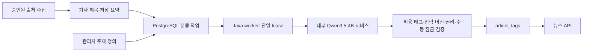

# 기사 주제 분류

## 결정
사용자가 Qwen3.5-4B를 선택했다. 번역(Index Translate 2B)과 분류(Qwen)를 별도 프로세스·이미지·키·네트워크·모델 볼륨으로 운영한다. 웹 요청에서는 모델을 호출하지 않는다. Linux CPU 기반이며 호스트 GPU나 Mac 전용 API에 의존하지 않는다.



## 주제 목록
초기값은 보안 취약점, LLM 모델·성능, RAG, 데이터베이스, 검색 기술·속도 5개다. 사용자 확정 목록을 대신한 고정 결론이 아니라 시작용 기본값이다. 관리자 화면의 **기사 주제 분류**에서 사용 태그와 포함/제외 기준을 수정한다. 새 태그는 기존 태그 운영에서 등록 후 선택한다. 1~8개, 정의당 200자, 기사 결과는 최대6개다. 빈 배열은 근거 부족/범위 밖이며 억지로 분류하지 않는다. 주제 이름은 기존 태그의 표시명을 사용한다.

기존 ai/PostgreSQL 등의 태그와 브라우저 개인 설정을 임의 병합하거나 삭제하지 않는다. 관리자 대표 관심사는 필요하면 새 주제 목록에 맞춰 별도로 선택한다. 주제 정의 변경 후 기존 기사는 순차 재분류되며 이전 태그는 새 성공 결과가 적용될 때 교체된다.

## 처리 경계
- 입력: 저장된 제목 최대500 code points + 저장 요약 최대1600 code points. 원문/초록을 다시 수집하거나 별도 저장하지 않는다. 개인 관심사·검색어·클릭·계정 정보는 입력에 포함하지 않는다.
- 내부 HTTP는 classifier:11436만 허용하며 운영 호스트 포트를 공개하지 않는다. 테스트용 loopback만 코드 허용. 별도 32자 이상 API key, redirect 금지, 연결3초/요청180초/응답8192바이트 제한.
- Q4_K_M, context4096, CPU2/thread2, parallel1, temperature0, seed42, max_tokens160, reasoning off, JSON-schema 제한. 모델 응답이 허용 태그인지 앱에서도 재검증한다. 제약 출력은 의미 정확성/프롬프트 주입 방어의 완전성을 보장하지 않는다.
- PostgreSQL runtime lease로 여러 worker에서도 분류 호출을 하나로 제한한다. 작업 lease4분, heartbeat30초, 최대3시도/30·60초 backoff. 만료 작업 복구, 실패는 FAILED로 남긴다. 실패 결과로 기존 태그를 덮지 않는다. 정책/입력 변경은 재시도 횟수를 초기화한다.
- 모델/프롬프트 버전 + 주제 정의 + 관리자 version을 policy hash로 묶고 기사 제목/요약 hash와 별도로 저장한다. 작업 payload에는 입력 전문이나 모델 출력 전문을 저장하지 않는다.
- 결과 적용 시 현재 공개/표시·요약 허용/이용권리, 내용 hash, 정책 hash, lease token/만료, 수동 잠금을 재확인한다. 수동 태그·locked 태그 보존. 보존 태그를 먼저 계산해 총6개 범위의 남은 슬롯만 자동 태그로 채운다. 기사 제목/요약 변경은 잠기지 않은 기존 LLM 태그를 무효화하며 기사 전체 태그 잠금도 존중한다.
- method=LLM, confidence=1은 선택된 주제의 멤버십 값이며 검증된 정답 확률이 아니다. 생성된 태그는 관리자가 검토/잠금 가능하다.
- 분류 서비스 미설정 시 기존 규칙 수집은 유지된다. 표준 start.sh 경로는 분류 서비스와 키를 설정하므로 신규 기사에는 규칙 태그 대신 비동기 모델 분류를 적용한다.

## 모델 공급망
- 원본: https://huggingface.co/Qwen/Qwen3.5-4B (Apache 2.0)
- 양자화 배포: https://huggingface.co/unsloth/Qwen3.5-4B-GGUF (Qwen 공식 원본과 구분)
- revision: `e87f176479d0855a907a41277aca2f8ee7a09523`
- 파일: `Qwen3.5-4B-Q4_K_M.gguf`, 2,740,937,888 bytes
- SHA256: `00fe7986ff5f6b463e62455821146049db6f9313603938a70800d1fb69ef11a4`
- llama.cpp: `8642541b255bfb5dc39cd351a178be09013a55d6` 소스/다운로드 checksum 고정. 기존 번역 이미지와 같은 빌드 기준.

초기화 컨테이너만 HF/CDN에 접속한다. 중간 `.part` 파일은 hash 통과 후에만 활성화하고, 기존 모델 파일도 매번 검증한다. 컨테이너 이미지에는 모델/키를 넣지 않는다. runtime은 내부 네트워크에서 읽기 전용 모델 볼륨을 사용한다. 모델 파일의 checksum은 파일 무결성 확인이며 학습 데이터나 모델 동작의 안전성 보증이 아니다.

## 실행
`.env`와 기존 DB 비밀값을 준비한 뒤 `sh scripts/deploy/start.sh local|public|server`로 모델 다운로드·검증·Compose 서비스를 일괄 실행한다. 첫 다운로드에는 인터넷과 약2.75GB 전송/5GB 모델 볼륨 공간이 필요하다. 기존 번역 모델 볼륨은 유지한다.

```sh
sh scripts/classification/classification-prepare.sh
docker compose -f compose.yaml -f scripts/deploy/compose-translation.yaml -f scripts/deploy/compose-classification.yaml up -d --build
```

기존 공개 서비스에는 위 명령에 `-f scripts/deploy/compose-public.yaml`을 추가하거나 start.sh public을 사용한다. 서버도 server overlay를 포함한다. classifier 자체를 공개 ingress로 라우팅하지 않는다.

분류4GiB와 번역4GiB의 limit은 각각의 상한이며 전체 시스템 필요 RAM이 아니다. DB/앱/기타 서비스를 포함해 자원 여유를 확보한다. CPU 처리시간은 기사 길이·서버 아키텍처에 따라 다르다. 큐를 이용하므로 지면 응답은 분류 완료를 기다리지 않는다. 시작 시 모든 기존 기사 분류가 완료된 것으로 표시하지 않는다.

## 관리자 API
- GET /api/v1/admin/classification: model policy와 catalog(version/topics/hash), 상태 집계, 최근20개 작업/오류 코드.
- PUT /api/v1/admin/classification/topics: `{version,topics:[{tagId,definition}]}`; ADMIN/CSRF, 이전 version은409. 변경 시 감사 이벤트 기록. 임의 실행 코드·모델 URL 입력 기능은 제공하지 않는다.

## Helm 사전 준비
classifier Deployment/Recreate/replica1, 모델 init container, 전용5Gi PVC(keep), 내부 ClusterIP11436, worker만 접근 가능한 ingress NetworkPolicy를 추가한다. Secret CLASSIFICATION_KEY 및 images.classifier registry digest가 필요하다. schema version11. 실제 설치는 하지 않는다.

기존 차트와 동일하게 init/download와 runtime이 Pod 네트워크를 공유하므로 egress는 자동 차단되지 않는다. 실제 클러스터 공개 전 모델 provisioning Job 또는 CNI egress 설계가 필요하다. Compose와 동일한 외부통신 차단을 보장한다고 하지 않는다. GPU/AMD64 실측·Kubernetes 설치는 별도 검증 대상이다.
